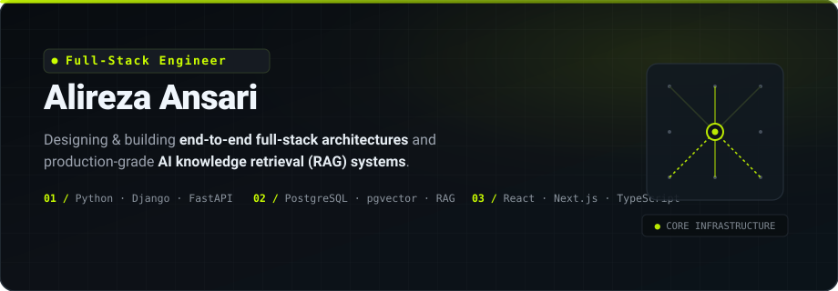

  

  
  &nbsp;
  
  &nbsp;
  
  &nbsp;
  

  <b>Full-Stack Software Engineer</b> building robust web applications, distributed backend services, and modular AI infrastructure. 
  Focused on thoughtful system architecture, rigorous data boundaries, and reliable end-to-end software products.

  

## ⚡ Engineering Philosophy

I approach software as an interconnected system rather than isolated snippets of code. My work centers on building software end-to-end: understanding constraints, modeling domain boundaries, designing schemas, implementing resilient APIs, and securing data pipelines.

- **Architecture Before Implementation**: Clear service contracts, bounded contexts, and explicit data isolation models before writing application logic.
- **Deep Fundamentals Over AI Reliance**: Leveraging AI tools to accelerate execution, but taking complete engineering ownership of code correctness, security, concurrency, and performance.
- **Production-First Mindset**: Automated test suites, strict typing, schema migrations, and Dockerized reproducible environments from day one.

  

## 🛠️ Featured Engineering Work

### [01 / Weirwise Core](https://github.com/ansarialireza/weirwise-core)
> **Open-Source Modular RAG & Knowledge Retrieval Infrastructure**  
> *Python | FastAPI | PostgreSQL | pgvector | Alembic | Docker | pytest*

Weirwise Core provides a self-hostable, production-ready backend for Retrieval-Augmented Generation (RAG). It abstracts asynchronous document ingestion, chunking pipelines, vector similarity search, and multi-tenant isolation into a clean developer API and standalone Python SDK.

- **Multi-Tenant Isolation**: Strict isolation across knowledge bases, assistants, documents, and query executions.
- **Native Vector Retrieval**: Direct pgvector integration with PostgreSQL for high-efficiency similarity search without heavy third-party database bloat.
- **Asynchronous Ingestion Worker**: Background pipeline processing PDF, TXT, and Markdown extraction with SHA-256 hashed API key authentication.
- **Python Client SDK**: Dedicated, typed client library (`packages/python-sdk`) published for rapid backend integration.
- **Verification & Testing**: Comprehensive automated test suite and database diagnostics CLI tools.

🔗 **Links**: [Repository & Codebase](https://github.com/ansarialireza/weirwise-core) | [Project Ecosystem (`weirwise.com`)](https://weirwise.com)

---

### [02 / Personal AI Assistant Platform](https://github.com/ansarialireza/personal-ai-assistant)
> **Full-Stack Multi-Channel AI Assistant & Knowledge Platform**  
> *Django 5.2 | DRF | Next.js | TypeScript | PostgreSQL | Docker Compose | Shadow DOM*

A standalone product platform for creating custom-scoped AI assistants, indexing domain documentation, orchestrating live conversations, and embedding interactive chat widgets.

- **Full-Stack Architecture**: Django REST Framework backend with Next.js frontend, token-based JWT authentication, and owner-scoped querysets.
- **Asynchronous Extraction & Sync**: Database-backed worker handling document ingestion (PDF, DOCX, TXT, MD) and website sitemap discovery with robots policy enforcement.
- **Multi-Channel Delivery**: Shared conversation routing across dashboard playground, Telegram bot webhooks with encrypted tokens, and embeddable Web Components.
- **Zero-Style Bleed Widget**: Custom embeddable element built using Shadow DOM and safe text rendering for third-party websites.
- **Operations Control Center**: Staff-scoped administrative diagnostics providing bounded, non-billable upstream service checks and real-time integration status.

🔗 **Links**: [Repository](https://github.com/ansarialireza/personal-ai-assistant)

  

## 🔬 Technical Capabilities & Tooling

| Domain | Technologies & Frameworks |
| :--- | :--- |
| **Backend & APIs** | `Python` | `Django` | `Django REST Framework` | `FastAPI` | `Alembic` | `Pydantic` | `RESTful Architecture` |
| **Frontend & UI** | `TypeScript` | `JavaScript` | `React` | `Next.js` | `Tailwind CSS` | `Web Components (Shadow DOM)` |
| **AI & Retrieval** | `RAG Pipelines` | `PostgreSQL pgvector` | `Document Ingestion & Chunking` | `Vector Search` | `LLM Tool Orchestration` |
| **Data & Storage** | `PostgreSQL` | `Redis` | `Database Schema Migration` | `Relational Modeling` |
| **DevOps & Tooling** | `Docker` | `Docker Compose` | `Git & GitHub Workflows` | `pytest` | `Ruff` | `Linux / WSL` |

  

## 🎯 Current Engineering Focus

- **Scaling Weirwise Ecosystem**: Refining retrieval benchmarks, enhancing ingestion adapters, and architecting evaluation tooling for RAG pipeline regression testing.
- **Reliable Agentic Workflows**: Designing resilient multi-step tool-calling patterns with clear error-recovery and state-machine transitions.
- **Systematic Full-Stack Craftsmanship**: Writing clean, testable, and maintainable software that delivers measurable business value.

  

## 📊 GitHub Analytics

  

  

## 📬 Let's Connect & Collaborate

Whether you're looking for a **Full-Stack Software Engineer** to build production-grade web systems, looking to implement **reliable RAG infrastructure**, or interested in collaborating on open-source tools:

- 💼 **LinkedIn**: [linkedin.com/in/ansarialireza](https://linkedin.com/in/ansarialireza/)
- 🌐 **Weirwise Project**: [weirwise.com](https://weirwise.com)
- 🖥️ **Portfolio**: [ansarialireza.github.io](https://ansarialireza.github.io/)
- ✉️ **Direct Email**: [anssrza@gmail.com](mailto:anssrza@gmail.com)

---

  Designed &amp; engineered by <b>Alireza Ansari</b> | Electric Lime Brand System (#CCFF00)

